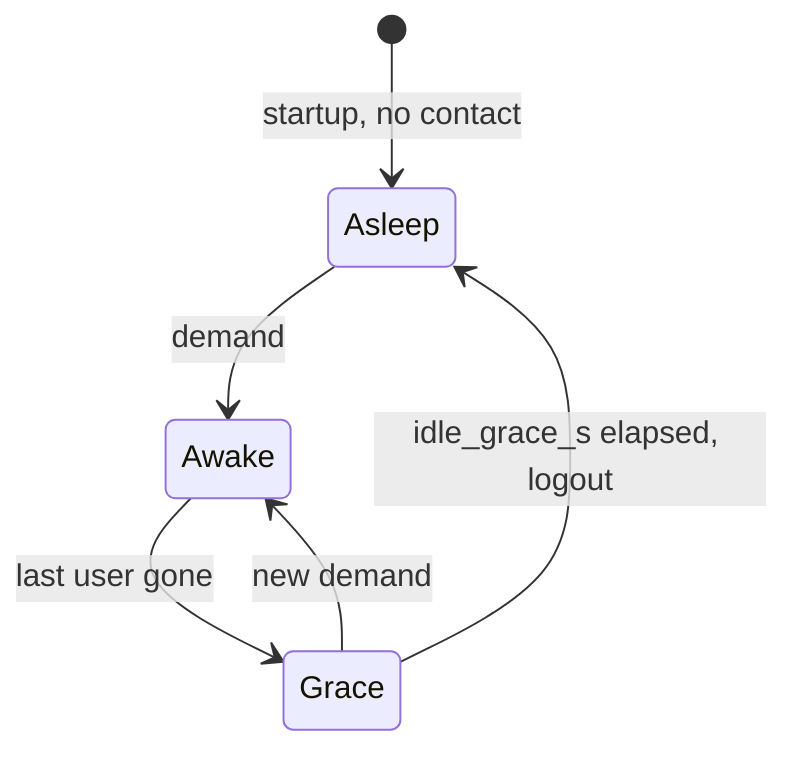

# Neolink


[](https://deps.rs/repo/github/QuantumEntangledAndy/neolink)

Neolink is a small program that acts as a proxy between Reolink IP cameras and
normal RTSP clients.
Certain cameras, such as the Reolink B800, do not implement ONVIF or RTSP, but
instead use a proprietary "Baichuan" protocol only compatible with their apps
and NVRs (any camera that uses "port 9000" will likely be using this protocol).
Neolink allows you to use NVR software such as Shinobi or Blue Iris to receive
video from these cameras instead.
The Reolink NVR is not required, and the cameras are unmodified.
Your NVR software connects to Neolink, which forwards the video stream from the
camera.

The Neolink project is not affiliated with Reolink in any way; everything it
does has been reverse engineered.

## This Fork

This fork is an extension of
[thirtythreeforty's](https://github.com/thirtythreeforty/neolink) with additional
features not yet in upstream master.

**Major Features**:

- MQTT
- Motion Detection
- Paused Streams (when no rtsp client or no motion detected)
- Save a still image to disk
- Power management: cameras are connected only while in use, so battery cameras
  can sleep (see [Power](#power-sleeping-and-always-on-cameras))

**Minor Features**:

- Improved error messages when missing gstreamer plugins
- Protocol more closely follows official reolink format
  - Possibly can handle more simulatenous connections
- More ways to connect to the camera. Including Relaying through reolink
  servers
- Camera battery levels can be displayed in the log

## Installation

**No GStreamer: the native backend (beta).** Neolink can also be built with its own RTSP
server, as a single static binary with nothing else to install (x86_64 and aarch64, plus
a ~15 MB `FROM scratch` image). See
[docs/native-rtsp/NATIVE.md](docs/native-rtsp/NATIVE.md); where it stands:
[docs/native-rtsp/STATUS.md](docs/native-rtsp/STATUS.md). The instructions below are for
the GStreamer build.


Download from the
[release page](https://github.com/QuantumEntangledAndy/neolink/releases)

Extract the zip

Install the latest [gstreamer](https://gstreamer.freedesktop.org/download/)
(1.20.5 as of writing this).

- **Windows**: ensure you install `full` when prompted in the MSI options.
- **Mac**: Install the dpkg version on the official gstreamer website over
  the brew version
- **Ubuntu/Debian**: These packages should work

```bash
sudo apt install \
  libgstrtspserver-1.0-0 \
  libgstreamer1.0-0 \
  libgstreamer-plugins-bad1.0-0 \
  gstreamer1.0-x \
  gstreamer1.0-plugins-base \
  gstreamer1.0-plugins-good \
  gstreamer1.0-plugins-bad \
  libssl
```

- **Windows**: You may also need to
  [install openssl](https://wiki.openssl.org/index.php/Binaries)
- **Macos**: You may also need to
  [install openssl](https://wiki.openssl.org/index.php/Binaries) or
  `brew install openssl@1.1`
- **Ubuntu/Debian**: Install the `libssl` package

Make a config file see below.

## Config/Usage

> **Upgrading? Cameras now sleep by default.** A camera with neither `battery` nor
> `idle_disconnect` in its config is no longer connected at startup or kept connected:
> neolink connects only while something uses it (an RTSP viewer, an MQTT command, a CLI
> command) and disconnects 10 s after. While it sleeps, MQTT motion and floodlight status
> aren't reported and `pause.on_motion` can't start the stream. This holds for both RTSP
> backends. **For every mains, PoE or NVR camera, add `battery = false`** to keep it
> connected as before. Battery and solar cameras need no change. Details:
> [Power: sleeping and always-on cameras](#power-sleeping-and-always-on-cameras) and
> [CHANGELOG.md](CHANGELOG.md).

### RTSP

To use `neolink` you need a config file.

There's a more complete example
[here](https://github.com/QuantumEntangledAndy/neolink/blob/master/sample_config.toml),
but the following should work as a minimal example.

```toml
bind = "0.0.0.0"

[[cameras]]
name = "Camera01"
username = "admin"
password = "password"
uid = "ABCDEF0123456789"

[[cameras]]
name = "Camera02"
username = "admin"
password = "password"
uid = "BCDEF0123456789A"
address = "192.168.1.10"
battery = false # a mains camera: stay connected
```

`Camera01` sets nothing about power, so it sleeps (is connected only while in use), which
suits a battery camera. `Camera02` is on mains power and stays connected.

Create a text file called `neolink.toml` in the same folder as the
neolink binary. With your config options.

When ready start `neolink` with the following command
using the terminal in the same folder the neolink binary is in.

```bash
./neolink rtsp --config=neolink.toml
```

### Discovery

To connect to a camera using a UID we need to find the IP address of the camera
with that UID

The IP is discovered with four methods

1. Local discovery: Here we send a broadcast on all visible networks asking
   the local network if there is a camera with this UID. This only works if
   the network supports broadcasts

   If you know the ip address you can put it into the `address` field of the
   config and attempt a direct connection without broadcasts. This requires a
   route from neolink to the camera.

2. Remote discovery: Here we ask the reolink servers what the IP address is.
   This requires that we contact reolink and provide some basic information
   like the UID. Once we have this information we connect directly to the
   local IP address. This requires a route from neolink to the camera and
   for the camera to be able to contact reolink.

3. Map discovery: In this case we register our IP address with reolink and ask
   the camera to connect to us. Once the camera either polls/recieves a connect
   request from the reolink servers the camera will initiate a connection
   to neolink. This requires that our IP and reolink are reachable from
   the camera.

4. Relay: In this case we request that reolink relay our connection. Neolink
   nor the camera need to be able to direcly contact each other. But both
   neolink and the camera need to be able to contact reolink.

This can be controlled with the config

```toml
discovery = "local"
```

In the `[[cameras]]` section of the toml.

Possible values are `local`, `remote`, `map`, `relay` later values implictly
enable prior methods.

Local discovery always runs first, on its own. The Reolink cloud methods are tried
only if it fails, and never at the same time: a cloud registration can wake a
battery camera through Reolink's servers. When a cloud method is allowed, local
discovery gives up after 8 s, so a camera reachable only through the cloud connects
up to 8 s later than when the methods ran in parallel. Discovery runs at every
connection, so for a sleeping camera at every wake.

#### Cellular

Cellular cameras should select `"cellular"` which only enables `map` and
`relay` since `local` and `remote` will always fail

```toml
discovery = "cellular"
```

See the sample config file for more details.

### MQTT

To use mqtt you will need to adjust your config file as such:

```toml
bind = "0.0.0.0"

[mqtt]
broker_addr = "127.0.0.1" # Address of the mqtt server
port = 1883 # mqtt servers port
credentials = ["username", "password"] # mqtt server login details

[[cameras]]
name = "Camera01"
username = "admin"
password = "password"
uid = "ABCDEF0123456789"
```

Then to start the mqtt+rtsp connection run the following:

```bash
./neolink mqtt-rtsp --config=neolink.toml
```

OR for only mqtt

```bash
./neolink mqtt --config=neolink.toml
```

Neolink will publish these messages:

Messages that are prefixed with `neolink/`

- `/status` Tracks the connection of neolink, `connected` for ready `offline`
  for not ready this is a LastWill message
- `/config` The configuration file used to start neolink, you can publish to
  this to **temporarily** alter the live configuration
- `/config/status` If you publish to `/config` then any errors from your
  publish config will show here, or `Ok(())` if no errors and finished loading

Messages that are prefixed with `neolink/{CAMERANAME}`

Control messages:

- `/control/led [on|off]` Turns status LED on/off
- `/control/ir [on|off|auto]` Turn IR lights on/off or automatically via light
  detection
- `/control/reboot` Reboot the camera
- `/control/ptz [up|down|left|right|in|out] (amount)` Control the PTZ
  movements, amount defaults to 32.0
- `/control/ptz/preset [id]` Move the camera to a PTZ preset
- `/control/ptz/assign [id] [name]` Set the current PTZ position to a preset ID
  and name
- `/control/zoom (amount)` Zoom the camera to the specified amount. Example: 1.0
  for normal and 3.5 for 3.5x zoom factor. This only works on cameras that support
  zoom
- `/control/pir [on|off]`
- `/control/floodlight [on|off]` Turns floodlight (if equipped) on/off
- `/control/floodlight_tasks [on|off]` Turns floodlight (if equipped) tasks on/off
  This is the automatic tasks such as on motion and night triggers
- `/control/wakeup (mins)` Keep a sleeping camera (the default, see
  [Power](#power-sleeping-and-always-on-cameras)) awake for the given whole
  minutes, at most 30 (larger values are capped, anything else is rejected with a
  `FAIL:` reply). A new wakeup replaces the pending one instead of adding to it, and
  `0` cancels it. It also ends when neolink stops or the camera is removed
- `/control/siren on` Signal the siren, the message is always "on" as there is no
  "off" signal for the siren

Every `/control/*` message needs the camera, so it wakes a sleeping camera for as
long as the command runs (each is recorded as `mqtt:<topic>` in `/status/wakes`).
`/query/*` messages don't wake a sleeping camera unless the payload is `fresh`; see
Query Messages below. Publish them without the retain flag: retained `/control/*` and `/query/*` messages are ignored with a warning, so
that a broker reconnect doesn't replay them and wake the camera.

Status Messages:

- `/status connected|disconnected` Whether neolink is connected to the camera
  right now. A sleeping camera is `disconnected` until something wakes it, so
  read this as "awake", not "working"
- `/status/battery` Sent in reply to a `/query/battery` an XML encoded version
  of the battery status. For a sleeping camera this is the reading from its last
  wake; the reply on `/query/battery` gives its age
- `/status/battery_level` A simple % value of current battery level, only
  published when `enable_battery` is true in the config. For a sleeping camera
  it is published once per wake, not every `battery_update` ms
- `/status/pir` Sent in reply to a `/query/pir` an XML encoded version of the
  pir status
- `/status/motion` Contains the motion detection alarm status. `on` for motion
  and `off` for still, only published when `enable_motion` is true in the config.
  The camera sends motion events only over an open connection, so for a sleeping
  camera this stays `unknown` until a wake and is updated only while it is awake.
  Motion that is `on` when the camera goes to sleep (or its connection drops) is
  published as `off`
- `/status/ptz/preset` Sent in reply to a `/query/ptz/preset` an XML encoded
  version of the PTZ presets
- `/status/preview` a base64 encoded camera image updated every 2s. Not
  every camera supports the snapshot command needed for this. In such cases
  there will be no `/status/preview` message. Only published when
  `enable_preview` is true in the config. For a sleeping camera it is the
  snapshot taken at each wake, published once per wake
- `/status/floodlight_tasks` The current status of the floodlight tasks
  used updated every 2s by default (for a sleeping camera, only while it is
  awake)
- `/status/wakes` The wake ledger, retained, published whenever the camera wakes
  or goes back to sleep: JSON with `awake`, `reason` (what woke it, e.g.
  `mqtt:control/wakeup`, `mqtt:query/battery` or `stream:Main`), `since` (Unix seconds),
  `last_awake_s`, `today_wakes`, `today_awake_s` and `last_hour_wakes`. A camera
  woken more than 12 times in an hour is also logged as a warning, with the reasons

Query Messages:

Each query is answered on its own topic with `OK` or `FAIL: <why>`. A query never
wakes a sleeping (battery) camera unless its payload is `fresh`; always-on
cameras answer every query live.

- `/query/battery` Request that the camera reports its battery level. A sleeping
  camera answers with the reading from its last wake (`OK: saved 120 s ago ...`),
  or `FAIL` if there is none yet. With the payload `fresh` it wakes the camera,
  unless the saved reading is at most 60 s old
- `/query/pir` Request that the camera reports its pir status. On a sleeping
  camera this needs the payload `fresh`, unless the camera is awake anyway
- `/query/ptz/preset` Request that the camera reports its PTZ presets (as
  `/query/pir` for sleeping cameras)
- `/query/preview` Request that the camera post a base64 encoded jpeg
  of the stream to `/status/preview` now, ignoring the timer. A sleeping camera
  posts the snapshot from its last wake; `fresh` wakes it as for `/query/battery`

Concurrent `fresh` queries on the same topic share one wake: the extra ones are
answered `OK: a fresh query is already waking the camera; its answer follows`.
Retained `control` and `query` messages are ignored.

### Controlling RTSP from MQTT

If neolink is started with `mqtt-rtsp` then the `/neolink/config` can be used
to control the RTSP

Changes made to the config by publishing to `/neolink/config` should be
reflected in the rtsp

These include changing the:

- Available users

```toml
[[users]]
  name = "me"
  pass = "mepass"
```

- Permitted users on a camera

```toml
[[cameras]]
  permitted_users = [ "me" ]
```

- Available streams

```toml
[[cameras]]
  stream = "Main"
```

Setting a value of `None` will disable the stream

- Disable the entire camera (mqtt updates and all)

```toml
[[cameras]]
  enabled = false
```

### MQTT Disable Features

Certain features like preview and motion detection may not be desired
you can disable them with the following config options.

None of these wake a sleeping camera: they only listen or poll while the camera
is already awake for another reason (see
[Power](#power-sleeping-and-always-on-cameras)). On an always-on camera they run
all the time, so disabling them saves a little traffic.

```toml
bind = "0.0.0.0"

[mqtt]
broker_addr = "127.0.0.1" # Address of the mqtt server
port = 1883 # mqtt servers port
credentials = ["username", "password"] # mqtt server login details

[[cameras]]
name = "Camera01"
username = "admin"
password = "password"
uid = "ABCDEF0123456789"
[cameras.mqtt]
enable_motion = false        # motion detection
                             # (passive: only while the camera is connected)
                             #
enable_light = false         # flood lights only available on some camera
                             # (passive: only while the camera is connected)
                             #
enable_battery = false       # battery updates in `/status/battery_level`
                             #
enable_preview = false       # preview image in `/status/preview`
                             #
enable_floodlight = false    # floodlight tasks status in `/status/floodlight_tasks`
                             #
battery_update = 2000        # Number of ms between `/status/battery_level` updates
                             # (always-on cameras; a sleeping camera
                             # publishes once per wake)
                             #
preview_update = 2000        # Number of ms between `/status/preview` updates
                             # (always-on cameras; a sleeping camera
                             # publishes once per wake)
                             #
floodlight_update = 2000     # Number of ms between `/status/floodlight_tasks` updates
```

#### MQTT Discovery

[MQTT Discovery](https://www.home-assistant.io/integrations/mqtt/#mqtt-discovery)
is partially supported. Currently, discovery is opt-in and camera features
must be manually specified.

```toml
[cameras.mqtt]
  # <see above>
  [cameras.mqtt.discovery]
  topic = "homeassistant"
  features = ["floodlight"]
```

Available features are:

- `floodlight`: This adds a light control to home assistant
- `camera`: This adds a camera preview to home assistant. It is only updated
  every 0.5s and cannot be much more than that since it is updated over mqtt
  not over RTSP. Not every camera supports the snapshot command needed for
  this. In such cases there will be no `/status/preview` message.
- `led`: This adds a switch to chage the LED status light on/off to home
  assistant
- `ir`: This adds a selection switch to chage the IR light on/off/auto to home
  assistant
- `motion`: This adds a motion detection binary sensor to home assistant
- `reboot`: This adds a reboot button to home assistant
- `pt`: This adds a selection of buttons to control the pan and tilt of the
  camera
- `battery`: This adds a battery level sensor to home assistant
- `siren`: Adds a siren button to home assistant

With discovery on, every camera also gets an **Awake** binary sensor, driven by
`neolink/<camera>/status`: on while neolink is connected to the camera. The
entities' availability follows `neolink/status` (whether neolink itself is
running), so a sleeping camera is not shown as unavailable.

### Extra Camera Settings

Listed below are extra camera settings:

```toml
[[cameras]]
name = "Camera01"
username = "admin"
password = "password"
uid = "ABCDEF0123456789"
debug = false # Displays Debug XML messages from camera
enabled = true # Enable or Disable the camera
update_time = false # When camera connects, force the setting of the camera date/time to now. The default is false
print_format = "None"  # Type of format that logs are displayed in (None, Human, Xml). The default is None
```

- **Debug:** Will dump the various XMLs from the camera as they are recieved
and decrypted. Leave this off unless asked for it to fix an issue.

- **Enabled:** Useful if you want to remove a camera from rtsp without deleting
it from the config

- **update_time:** Used to FORCE an update on the camera time. Usually it checks
if it is needed but this
will force it regardless. (Mostly this was introduced to address a specific
ssue a user had)

- **print_format:** Used for adjusting printing of some values mostly, battery
messages

### Pause

To use the pause feature you will need to adjust your config file as such:

```toml
bind = "0.0.0.0"

[[cameras]]
name = "Camera01"
username = "admin"
password = "password"
uid = "ABCDEF0123456789"
battery = false # on_motion needs a connected camera, see below
  [cameras.pause]
  on_motion = true # Should pause when no motion
  on_client = true # Should pause when no rtsp client
  timeout = 2.1 # How long to wait after motion stops before pausing
```

Then start the rtsp server as usual:

```bash
./neolink rtsp --config=neolink.toml
```

`on_motion` needs motion events, and a camera sends those only while neolink is
connected to it. On a camera that sleeps (the default, see
[Power](#power-sleeping-and-always-on-cameras)) it **cannot start the stream on
motion**, and neolink warns about it at startup. Use it on a mains camera with
`battery = false`, or on a battery camera with `idle_disconnect = false`, which keeps
it connected and drains its battery. Each motion event keeps the camera connected for
at most `motion_hold_max_s` seconds (default 120).

### Power: sleeping and always-on cameras

> **Changed in this version.** Neolink used to stay connected to every camera all the
> time unless you set `idle_disconnect = true`. Now a camera **sleeps by default**:
> neolink connects to it only while something needs it. That is the right default for
> battery and solar cameras. A mains, PoE or NVR camera needs `battery = false` to stay
> connected as before. See
> [Upgrading: cameras now connect on demand](#upgrading-cameras-now-connect-on-demand).

This applies to both RTSP backends (GStreamer and native) and to every mode (`rtsp`,
`mqtt`, `mqtt-rtsp` and the CLI commands).

#### Sleeping or always-on

Each `[[cameras]]` entry is either **sleeping** (connected on demand) or **always-on**.
Two keys decide which:

| `idle_disconnect` | `battery` | Result |
|---|---|---|
| unset | unset | **Sleeps** (unknown power is treated as battery) |
| unset | `true` | Sleeps |
| unset | `false` | Always-on |
| `true` | any | Sleeps |
| `false` | any | Always-on (logs a warning unless `battery = false`) |

`idle_disconnect` (aliases `idle`, `idle_disc`) wins when it is set; otherwise `battery`
decides. Neolink does not detect mains power by itself. It records in its state file that
a camera has a battery once a battery read succeeds, but that never changes whether the
camera sleeps: only the config does.

**What to set, by camera type:**

| Camera | Set | What you get |
|---|---|---|
| Battery (Argus, Go, …) | Nothing (or `battery = true`) | Sleeps. Wakes for a viewer, a command or a `?fresh=1` snapshot, and sleeps again `idle_grace_s` after the last one |
| Solar-charged battery | Nothing (or `battery = true`) | Same as battery |
| Mains or PoE | `battery = false` | Always connected, as before this change: MQTT motion, floodlight status and the timed preview and battery updates all work |
| NVR channel (`channel_id`) of a wired camera | `battery = false` | Always connected, as before. Each `[[cameras]]` entry has its own connection to the NVR and follows these rules by itself |
| Battery camera you want connected anyway (24/7 recording, `pause.on_motion`) | `idle_disconnect = false` | Always connected; a battery-drain warning at startup; drains the battery |
| Mains camera you want on demand | `idle_disconnect = true` (or leave both unset) | Sleeps like a battery camera |

#### What wakes a sleeping camera

A sleeping camera is **not contacted at startup**. It is connected only while something
uses it, and released `idle_grace_s` seconds (default 10) after the last use ends:



These wake it:
- **An RTSP client.** With the GStreamer backend, any client that connects starts the
  camera stream and so wakes it, including a `DESCRIBE`-only health check. The native
  backend answers `DESCRIBE` from a cache and wakes the camera only on `PLAY`, or to
  learn a stream it has never seen (at most once per camera per 10 minutes).
- **MQTT `control/*` messages**, while the command runs (at most 60 s each).
  `control/wakeup <minutes>` keeps the camera awake for that many minutes, at most 30;
  a new one replaces the pending one and `0` cancels it.
- **MQTT `query/*` messages with the payload `fresh`** (several at once share one wake;
  a battery or preview reading at most 60 s old is answered without waking). Without
  `fresh`, queries are answered from the last wake and never wake the camera.
- **CLI commands**: `pir`, `ptz`, `reboot`, `status-light`, `talk` and so on.
  `battery` and `image` print what was saved at the last wake without waking the camera;
  `--fresh`, or having nothing saved yet, wakes it (`image --use-stream` always does).
- **`/<camera>/snapshot.jpg?fresh=1`** on the snapshot endpoint, only when the camera has
  `snapshot_fresh = true`, and at most once a minute.

These **never** wake it:
- the snapshot endpoint without `?fresh=1` (it serves the picture saved at the last wake);
- the MQTT preview, battery and floodlight timers;
- motion (the camera sends motion events only over an open connection, see below).

Each time a sleeping camera is released, neolink logs one line at info level, for example
`argus: awake 23.4 s for stream:Main; today: 3 wakes, 71 s awake`. With MQTT, the same
ledger is published retained on `neolink/<camera>/status/wakes`, and a camera woken more
than 12 times in an hour is logged as a warning naming what woke it.

#### What changes for a sleeping camera

While a camera sleeps, neolink has no connection to it, so anything that relies on the
camera sending data stops until the next wake:

- **MQTT motion** (`status/motion`) is reported only while the camera is awake. It reads
  `unknown` until then: a sleeping camera can't tell neolink about motion.
- **`pause.on_motion` can't start the stream** on a sleeping camera, for the same reason.
  Neolink logs a warning at startup for such a camera. Set `idle_disconnect = false` (or
  `battery = false` on a mains camera) if you need it. A motion event keeps an awake
  camera connected for at most `motion_hold_max_s` seconds (default 120).
- **Floodlight status** (`status/floodlight`, `status/floodlight_tasks`) is updated only
  while the camera is awake.
- **MQTT preview and battery level** (`status/preview`, `status/battery_level`) are
  published once per wake, from the snapshot and battery reading taken during that wake,
  not every `preview_update`/`battery_update` ms.
- **`neolink/<camera>/status`** is `disconnected` while the camera sleeps and `connected`
  while it is awake: it now means "awake", not "working". Home Assistant availability
  comes from `neolink/status` (see [MQTT Discovery](#mqtt-discovery)).
- **Push notifications** (only in builds with the optional `pushnoti` feature, which the
  default and native builds leave out) wake a sleeping camera only when
  `pause.on_motion` is set. Google removed the API they relied on, so don't count on
  them.
- **`update_time`** and the camera clock check run when neolink connects, so on a
  sleeping camera only at a wake.
- **The first viewer waits** for the camera to wake. On an Argus PT Ultra this measured
  under 1 s when it was awake, about 2 s from a light sleep and about 7 s from deep sleep.
  With the native backend the client sees the last keyframe meanwhile.

#### Settings

| Key | Where | Default | What |
|---|---|---|---|
| `battery` | camera | unset (treated as battery) | `false` marks a mains camera, which then stays connected |
| `idle_disconnect` | camera | unset (follows `battery`) | `true` forces sleeping, `false` forces always-on |
| `idle_grace_s` | camera | `10` | Seconds a sleeping camera stays connected after its last use |
| `motion_hold_max_s` | camera | `120` | Longest a motion event keeps the camera connected (with `pause.on_motion`) |
| `snapshot_fresh` | camera | `false` | Allow `?fresh=1` on the snapshot endpoint, which wakes the camera |
| `snapshot_port` | top level | `bind_port + 1` | The snapshot endpoint; `0` turns it off |

A config published to `neolink/config` over MQTT can change `battery`, `idle_disconnect`
and `idle_grace_s` while neolink runs; the camera switches between sleeping and always-on
at once. The MQTT preview and battery-level publishing (timed, or once per wake) only
follows such a switch after a restart or a change to that camera's `[cameras.mqtt]`.

#### What neolink logs about it

| Level | When | Message |
|---|---|---|
| info | Startup, for a camera with neither `battery` nor `idle_disconnect` set | ``<camera>: connects only while in use (battery or unknown power); set `battery = false` to keep a mains camera connected as before`` |
| warn | Startup, `idle_disconnect = false` without `battery = false` | `<camera>: idle_disconnect is off: keeps the camera awake; expect battery drain on battery cameras` |
| warn | Startup, `pause.on_motion` on a sleeping camera | `<camera>: pause.on_motion on a camera that sleeps: motion events arrive only over an open connection, …` |
| warn | A sleeping camera has streamed for 30 min straight | `<camera> has streamed continuously for 30 min; battery cameras are not designed for continuous recording` |
| info | Each time a sleeping camera is released | `<camera>: awake <s> s for <reasons>; today: <n> wakes, <s> s awake` |
| warn | A second neolink process uses the same camera | `Another neolink process (pid <pid>) uses this camera too; each one wakes it separately` |

The default log level is info, so all of these show without `RUST_LOG`. If you see the
30-minute warning for a mains camera, set `battery = false` on it.

#### The snapshot endpoint

In `rtsp` and `mqtt-rtsp` modes neolink serves
`http://<bind>:<bind_port + 1>/<camera>/snapshot.jpg`: the picture taken during the
camera's last wake. Fetching it never wakes the camera. Until the first wake it returns a
grey placeholder (HTTP 200).
- With no `[[users]]`, anyone who can reach the port may fetch it. Otherwise it takes HTTP
  Basic auth, and honours `permitted_users`.
- `?fresh=1` takes a new picture, waking the camera. It is refused (403) unless the camera
  has `snapshot_fresh = true`, and it runs at most once a minute per camera.
- Set `snapshot_port = 0` to turn it off, or another port if `bind_port + 1` is taken
  (8555 is also go2rtc's WebRTC port).

#### State directory

What neolink learns at each wake (UID, model, firmware, streams, the last battery reading
and the last snapshot) is kept per camera in `<state dir>/camera/<name>-<hash>.json`, with
the snapshot next to it as `<name>-<hash>.jpg`. The native backend also keeps its stream
cache (`cache/`) and learning-limit files there. The state directory is the first of:

1. `$NEOLINK_STATE_DIR` (the Docker images set it to `/var/lib/neolink`);
2. `$XDG_STATE_HOME/neolink`;
3. `~/.local/state/neolink`;
4. `/tmp/neolink`.

Keep it across restarts (in Docker, mount a volume on `/var/lib/neolink`). Without it,
neolink forgets the last snapshot and battery reading, and the native backend wakes a
battery camera more often to relearn its streams. The snapshot is a picture of what the
camera saw: protect the directory like the config.

#### Home Assistant and Frigate with battery cameras

- Use the snapshot endpoint as the camera's still image URL.
- Turn "Preload stream" off, and use `camera_view: auto`, not `live`.
- Don't give the camera a go2rtc or Frigate `preload:`, `command_line` polling, or a ping
  or nmap device tracker on its IP: each one keeps it awake or wakes it.
- **Frigate records continuously**, so a camera Frigate records never sleeps. That is fine
  for a mains camera (set `battery = false`) but drains a battery camera.

#### Upgrading: cameras now connect on demand

If you are upgrading from a version where every camera stayed connected:

1. On every **mains, PoE or NVR-channel** camera, add `battery = false` to its
   `[[cameras]]` entry. It then behaves as before.
2. On **battery and solar** cameras, add nothing (or `battery = true`, which also silences
   the startup info line). They now sleep between uses.
3. If you had `idle_disconnect = true`, keep it: it still forces sleeping, even with
   `battery = false`. On a battery camera you can also remove it, since sleeping is now
   the default. Either way the camera is now released `idle_grace_s` (10 s) after the
   last use instead of 30 s, and it is no longer connected at startup.
4. If you rely on MQTT `status/motion`, floodlight status or `pause.on_motion` for a
   battery camera, that camera now needs `idle_disconnect = false`, which drains its
   battery.
5. If you used `neolink/<camera>/status` as an "online" signal, it now means "awake". Use
   `neolink/status` for availability.
6. In Docker, mount a volume on `/var/lib/neolink` so the state directory survives
   restarts.

At startup neolink logs an info line for every camera that sleeps only because neither
key is set: check that list after upgrading.

### Docker

[Docker](https://hub.docker.com/r/quantumentangledandy/neolink) builds are also
provided in multiple architectures. The latest tag tracks master while each
branch gets it's own tag.

```bash
docker pull quantumentangledandy/neolink

# Add `-e "RUST_LOG=debug"` to run with debug logs
#
# --network host is only needed if you require to connect
# via local broadcasts. If you can connect via any other
# method then normal bridge mode should work fine
# and you can ommit this option. Not all OSes support
# network=host, notably macos lacks this option.
docker run --network host --volume=$PWD/config.toml:/etc/neolink.toml quantumentangledandy/neolink
```

An image built from this repository's `Dockerfile` also keeps what neolink learns about
each camera (last snapshot, battery reading, streams) in `/var/lib/neolink`. Mount a
volume there so it survives restarts:

```bash
docker run --network host \
  --volume=$PWD/config.toml:/etc/neolink.toml \
  --volume=neolink-state:/var/lib/neolink \
  neolink
```

#### Environmental Variables

The container uses these environment variables:

- `NEO_LINK_MODE`: defaults to `"rtsp"` if not set, other options are "mqtt" or "mqtt-rtsp".
- `NEO_LINK_PORT`: defaults to `8554`. It only sets the port the image declares
  (`EXPOSE`); the RTSP port itself is `bind_port` in the config.
- `NEOLINK_STATE_DIR`: the state directory, `/var/lib/neolink` in the image (see
  [State directory](#state-directory)).
- `PUID` / `PGID`: when set and neolink runs as root, it switches to that user and
  group after reading the config, and hands the state directory to them first.

### Image

You can write an image from the stream to disk using:

```bash
neolink image --config=config.toml --file-path=filepath CameraName
```

Where filepath is the path to save the image to and CameraName is the name of
the camera from the config to save the image from.

File is always jpeg and the extension given in filepath will be added or changed
to reflect this.

By default this writes the snapshot taken during the camera's last wake, without
waking it, and prints its age. Add `--fresh` to wake the camera for a new one
(also done when nothing is saved yet). `--use-stream` always wakes the camera.

Some cameras do not support the SNAP command that is used to generate the image
on the camera. If this is the case with your camera you can try the
`--use-stream` option which will instead create a jpeg by transcoding the video
stream.

This command always connects to the camera, so it wakes a sleeping one. To get the
last picture without waking it, fetch it from the
[snapshot endpoint](#the-snapshot-endpoint) instead.

### Battery Levels

You can get the battery level and status using

```bash
neolink battery --config=config.toml CameraName
```

This will produce an xml formatted battery status on stdout for processing.

It prints the reading taken during the camera's last wake, with its age on stderr,
and does not wake the camera. Add `--fresh` to wake the camera for a new reading.
With no saved reading yet it wakes the camera anyway.

### PIR

You can control pir using

```bash
neolink pir --config=config.toml CameraName [on|off]
```

This will turn the PIR on or off

### Reboot

You can reboot a camera using

```bash
neolink reboot --config=config.toml CameraName
```

### Status LED

You can control the status LED using

```bash
neolink status-light --config=config.toml CameraName [on|off]
```

### Talk

You can talk over the camera using

```bash
neolink talk --config=config.toml --adpcm-file=data.adpc\
               --sample-rate=16000 --block-size=512 CameraName
```

Where the sounds is ADPCM encoded

or

```bash
neolink talk --config=config.toml --microphone  CameraName
```

Which uses the default microphone which depends on
[gstreamer](https://gstreamer.freedesktop.org/documentation/autodetect/autoaudiosrc.html?gi-language=c#autoaudiosrc-page)

### PTZ

You can control the PTZ using

```bash
neolink ptz --config=config.toml CameraName control 32 [left|right|up|down|in|out]
```

Where 32 is the speed. Not all cameras support speed

Some cameras also support preset positions

```bash
# Print the list of preset positions
neolink ptz --config=config.toml CameraName preset
# Move the camera to preset ID 0
neolink ptz --config=config.toml CameraName preset 0
# Save the current position as preset ID 0 with name PresetName
neolink ptz --config=config.toml CameraName assign 0 PresetName
```

To change the zoom level use the following:

```bash
# Zoom the camera to 2.5x
neolink ptz --config=config.toml CameraName zoom 2.5
```

With 1.0 being normal and 2.5 being 2.5x zoom

## License

Neolink is free software, released under the GNU Affero General Public License
v3.

This means that if you incorporate it into a piece of software available over
the network, you must offer that software's source code to your users.

## Donations

If you find this code helpful please consider supporting development.

[](https://ko-fi.com/G2G5HOYIZ)
